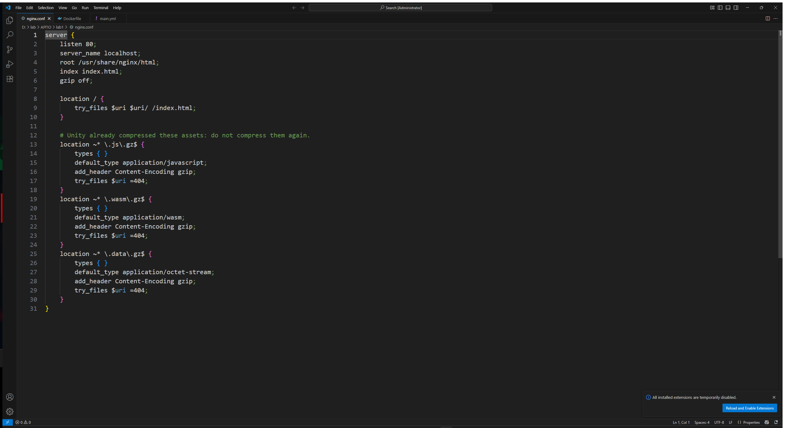
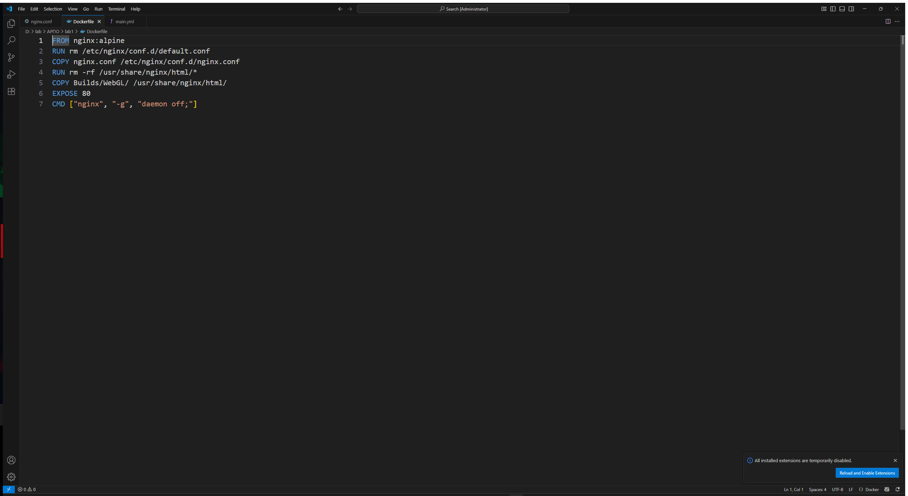
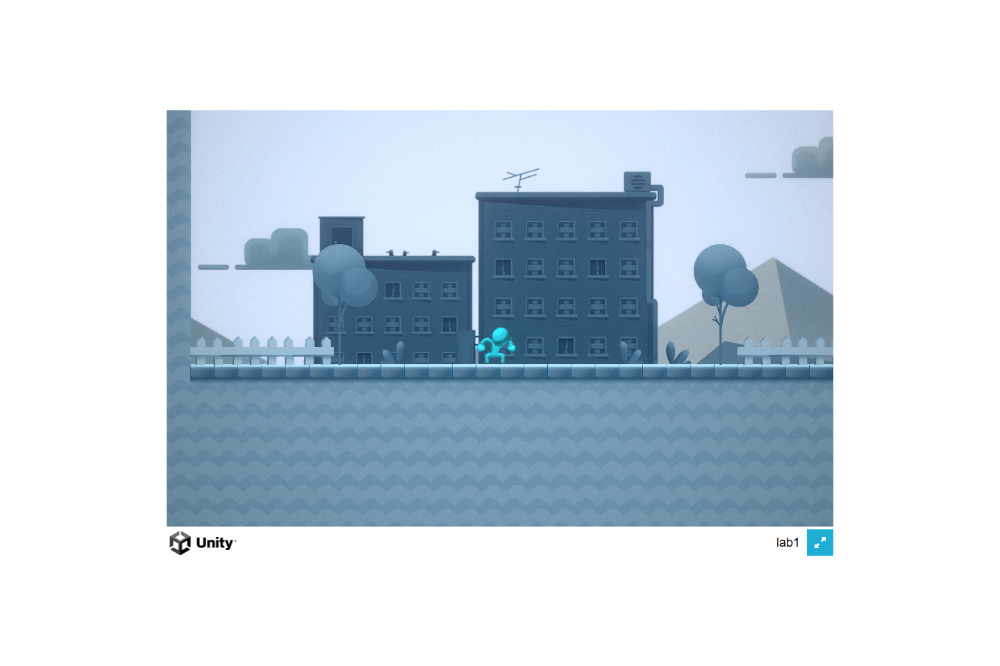
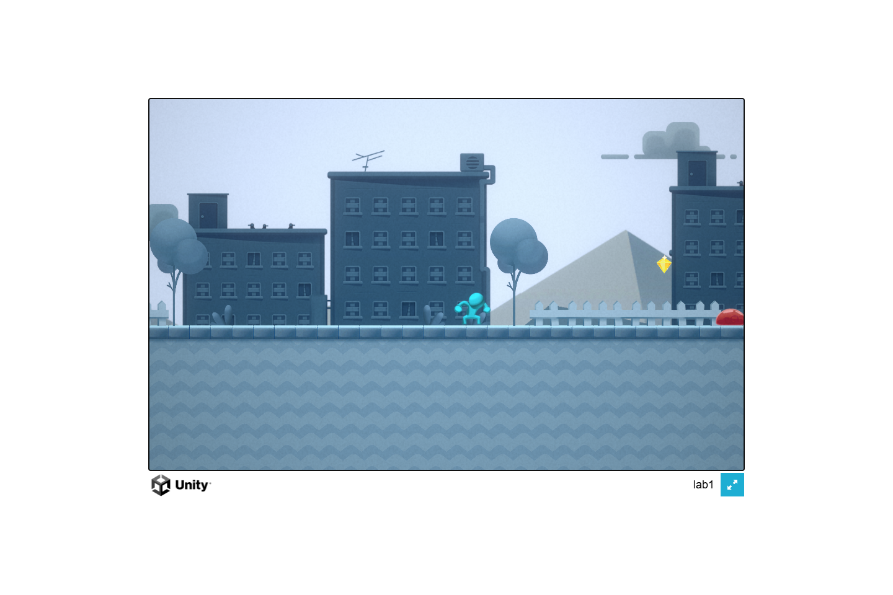
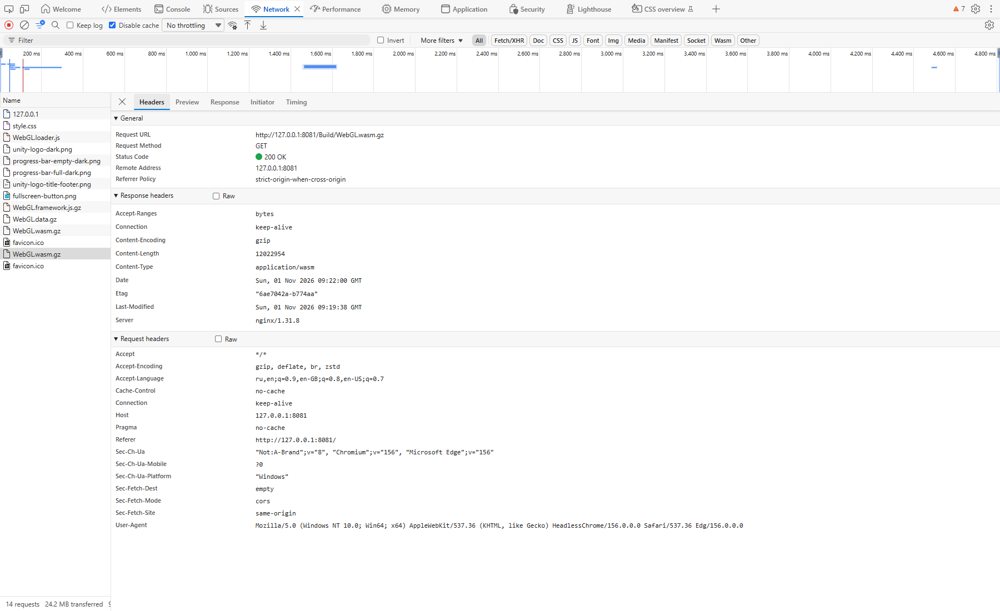
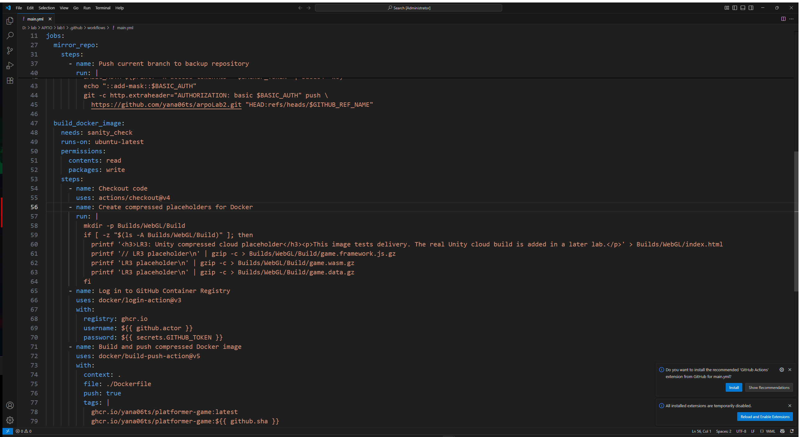
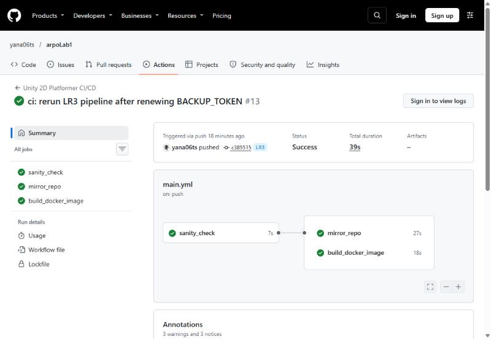

## 1. Настройки Unity и сборка

В Player Settings установлены:

- **Compression Format: Gzip**;
- **Decompression Fallback: выключен**.

Команда сборки в PowerShell:

& "D:\apps\Unity\Unity Hub\6000.3.2f1\Editor\Unity.exe" -batchmode -nographics -projectPath "D:\lab\АРПО\lab1" -buildTarget WebGL -executeMethod BuildManager.BuildWebGL -quit -logFile "D:\lab\АРПО\lab1\Logs\build_webgl_lr3_final.log"

Метод BuildManager.BuildWebGL берёт включённые сцены из настроек сборки и передаёт их в BuildPipeline.BuildPlayer. Результат записывается в Builds/WebGL. Лог нужен для поиска ошибок.

### Результат пересборки

| Файл | Без Gzip, байт | С Gzip, байт |
| --- | ---: | ---: |
| WebGL.data.gz | 15 824 286 | 8 221 369 |
| WebGL.framework.js.gz | 452 214 | 88 322 |
| WebGL.wasm.gz | 48 432 170 | 12 022 954 |
| Всего | 64 708 670 | 20 332 645 |

## 2. Nginx

В корне проекта создан nginx.conf.

| Расширение | Content-Type | Content-Encoding |
| --- | --- | --- |
| .js.gz | application/javascript | gzip |
| .wasm.gz | application/wasm | gzip |
| .data.gz | application/octet-stream | gzip |

types { } не позволяет стандартной таблице MIME заменить нужный тип на тип обычного gzip-архива. `gzip off` исключает повторное сжатие. Несуществующие сжатые ресурсы возвращают 404, а не HTML-страницу игры.

## 3. Docker

Создан Dockerfile:

1. Используется официальный образ nginx:alpine.
2. Удаляется стандартная конфигурация.
3. Копируется наша конфигурация Nginx.
4. В веб-каталог копируется настоящая локальная WebGL-сборка.
5. Объявляется порт 80.
6. Nginx запускается в основном процессе контейнера: daemon off;.

Файл .dockerignore ограничивает контекст сборки конфигурацией и WebGL-файлами. Папки Library, исходники, история Git и настройки редактора в образ не попадают.

## 4. Локальное тестирование

Адрес игры: http://localhost:8081.

**Проверено локально:** Nginx проходит nginx -t; игра загружается в Edge; ввод ArrowRight двигает персонажа и камеру; ошибок JavaScript не обнаружено. У всех трёх gzip-ресурсов — HTTP 200, правильный Content-Type и Content-Encoding: gzip. SHA-256 распакованных ответов совпадает с локальными файлами. Отсутствующий wasm-ресурс возвращает 404. 

Проверка в браузере: открыть F12 → Network, перезагрузить страницу, выбрать .wasm.gz, открыть Headers. Должны присутствовать Content-Encoding: gzip и Content-Type: application/wasm.

## 5. GitHub Actions и GHCR

Три задачи:

- sanity_check — проверяет структуру Unity-проекта и наличие файлов доставки;
- mirror_repo — отправляет текущую ветку в резервный репозиторий, используя существующий секрет BACKUP_TOKEN;
- build_docker_image — создаёт заглушки, входит в GHCR и собирает Docker-образ.

 После замены токена новым прогон полностью зелёный, все три задачи прошли успешно:

