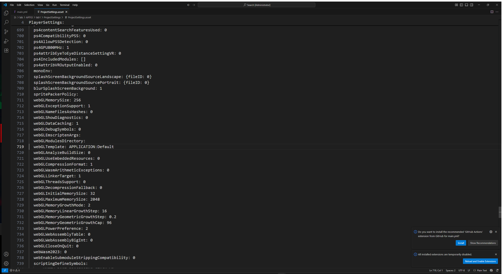

# Лабораторная работа №3

**Тема:** контейнеризация веб-сервера в Docker и раздача сжатых файлов Unity через Nginx.

**Проект:** Unity 6000.3.2f1, 2D Platformer Microgame.
**Основной репозиторий:** https://github.com/yana06ts/arpoLab1
**Резервный репозиторий:** https://github.com/yana06ts/arpoLab2

## 1. Настройки Unity и сборка

Для установленного редактора добавлен официальный модуль Web Build Support. Контрольная MD5 установщика совпала с метаданными Unity Hub: `7688a8ee093ff67280a26175e6cbc7b2`.

В Player Settings установлены:

- **Compression Format: Gzip**;
- **Decompression Fallback: выключен**.

Это соответствует `webGLCompressionFormat: 1` и `webGLDecompressionFallback: 0` в `ProjectSettings/ProjectSettings.asset`.



Команда сборки в PowerShell:

```powershell
& "D:\apps\Unity\Unity Hub\6000.3.2f1\Editor\Unity.exe" -batchmode -nographics -projectPath "D:\lab\АРПО\lab1" -buildTarget WebGL -executeMethod BuildManager.BuildWebGL -quit -logFile "D:\lab\АРПО\lab1\Logs\build_webgl_lr3_final.log"
```

Метод `BuildManager.BuildWebGL` берёт включённые сцены из настроек сборки и передаёт их в `BuildPipeline.BuildPlayer`. Результат записывается в `Builds/WebGL`. Лог нужен для поиска ошибок.

Важно проверять не только сообщение «Build Successful», но и новые файлы `.framework.js.gz`, `.wasm.gz`, `.data.gz`: старые файлы без сжатия могут оставаться от предыдущей сборки.

### Результат пересборки

| Файл | Без Gzip, байт | С Gzip, байт |
| --- | ---: | ---: |
| WebGL.data.gz | 15 824 286 | 8 221 369 |
| WebGL.framework.js.gz | 452 214 | 88 322 |
| WebGL.wasm.gz | 48 432 170 | 12 022 954 |
| Всего | 64 708 670 | 20 332 645 |

Объём трёх основных ресурсов уменьшился примерно в 3,18 раза (на 68,6%). Сборка завершилась с кодом 0. Лог: Logs/build_webgl_lr3_final.log.

## 2. Nginx

В корне проекта создан [nginx.conf](nginx.conf). Файлы игры обслуживаются из `/usr/share/nginx/html`.

| Расширение | Content-Type | Content-Encoding |
| --- | --- | --- |
| .js.gz | application/javascript | gzip |
| .wasm.gz | application/wasm | gzip |
| .data.gz | application/octet-stream | gzip |

`types { }` не позволяет стандартной таблице MIME заменить нужный тип на тип обычного gzip-архива. `gzip off` исключает повторное сжатие. Несуществующие сжатые ресурсы возвращают 404, а не HTML-страницу игры.


## 3. Docker

Создан [Dockerfile](Dockerfile):

1. Используется официальный образ `nginx:alpine`.
2. Удаляется стандартная конфигурация.
3. Копируется наша конфигурация Nginx.
4. В веб-каталог копируется настоящая локальная WebGL-сборка.
5. Объявляется порт 80.
6. Nginx запускается в основном процессе контейнера: `daemon off;`.

Файл [.dockerignore](.dockerignore) ограничивает контекст сборки конфигурацией и WebGL-файлами. Папки Library, исходники, история Git и настройки редактора в образ не попадают.


## 4. Локальное тестирование

```powershell
$env:Path += ";$env:LOCALAPPDATA\Programs\DockerDesktop\resources\bin"
docker build -t platformer-compressed:v1 .
docker run -d -p 127.0.0.1:8081:80 --name unity_compressed_container platformer-compressed:v1
docker exec unity_compressed_container nginx -t
```

Адрес игры: http://localhost:8081. Порт 8080 занят сервером National Instruments, поэтому выбран свободный 8081.

**Проверено локально:** Nginx проходит nginx -t; игра загружается в Edge; ввод ArrowRight двигает персонажа и камеру; ошибок JavaScript не обнаружено. У всех трёх gzip-ресурсов — HTTP 200, правильный Content-Type и Content-Encoding: gzip. SHA-256 распакованных ответов совпадает с локальными файлами. Отсутствующий wasm-ресурс возвращает 404. Подробные результаты: [verification.json](docs/LR3/verification.json).


Проверка в браузере: открыть F12 → Network, перезагрузить страницу, выбрать `.wasm.gz`, открыть Headers. Должны присутствовать `Content-Encoding: gzip` и `Content-Type: application/wasm`.

Остановка после проверки:

```powershell
docker stop unity_compressed_container
docker rm unity_compressed_container
```

## 5. GitHub Actions и GHCR

Обновлён `.github/workflows/main.yml` (в ветке `LR3`). Пайплайн запускается при push в `main`, `LR3` и вручную.

Три задачи:

- `sanity_check` — проверяет структуру Unity-проекта и наличие файлов доставки;
- `mirror_repo` — отправляет текущую ветку в резервный репозиторий, используя существующий секрет BACKUP_TOKEN;
- `build_docker_image` — создаёт заглушки, входит в GHCR и собирает Docker-образ.

Для третьей задачи заданы разрешения `contents: read` и `packages: write`.

Теги:

```text
ghcr.io/yana06ts/platformer-game:latest
ghcr.io/yana06ts/platformer-game:<SHA коммита>
```

Вместо пустых файлов `touch` созданы настоящие gzip-потоки через `gzip -c`. Их содержимое всё ещё является заглушкой, а не скомпилированной игрой. Это позволяет проверить доставку файлов без ложного обещания облачной Unity-сборки.

Резервная ветка обновляется обычным push: существующая история не перезаписывается принудительно.


**Результат в облаке.** Ветка `LR3` отправлена на GitHub. Первый прогон (#5) прошёл `sanity_check` и `build_docker_image`, но упал на `mirror_repo`: токен `BACKUP_TOKEN` из ЛР2 перестал действовать (по-видимому, истёк срок). После замены токена новым прогон #13 полностью зелёный, все три задачи прошли успешно:


Образ опубликован в GitHub Packages как `ghcr.io/yana06ts/platformer-game` с тегами `latest` и SHA коммита. Начиная с ЛР5 в него попадает настоящая игра вместо заглушек (скриншот пакета — в [LR5.md](LR5.md)).

## Как это работает простыми словами

Unity превращает игру в файлы для браузера. Большие файлы упаковываются в Gzip, поэтому передаются быстрее.

Nginx — программа, которая отдаёт эти файлы браузеру. Он добавляет пометку «это Gzip». Браузер видит пометку, распаковывает файл встроенными средствами и запускает игру.

Docker упаковывает Nginx, настройки и файлы игры в один образ. Из образа запускается контейнер — работающий сервер. Запись `8081:80` означает: обращения к порту 8081 компьютера направляются на порт 80 Nginx внутри контейнера.

GitHub Actions выполняет команды автоматически после отправки кода. GHCR хранит готовые образы: `latest` указывает на последний опубликованный образ, а SHA позволяет найти конкретную версию.

## Контрольные вопросы

**1. Что исправляет Content-Encoding: gzip?**
Сообщает браузеру, что тело ответа сжато. Без этого браузер пытается прочитать архив как JavaScript или WebAssembly и загрузка завершается ошибкой. Этот заголовок сам ничего не сжимает.

**2. Почему в облаке нужны временные файлы?**
Папка Builds исключена из Git. Облачный сервер получает исходники без WebGL-сборки, и команда COPY в Dockerfile не смогла бы скопировать отсутствующую папку. В этой работе заглушки проверяют инфраструктуру; позже их заменит облачная сборка Unity.

**3. Куда копировать игру в контейнере?**
В `/usr/share/nginx/html/`, веб-каталог официального образа Nginx.

**4. Зачем два тега?**
`latest` удобен для получения последней версии. SHA коммита позволяет определить исходный код образа и вернуться к конкретной сборке. Сам по себе тег можно перезаписать, поэтому для строгой неизменяемости используют digest образа.

## Вывод

Настроена схема доставки сжатой WebGL-игры через Nginx в Docker. Разделены локальная игровая сборка и учебный облачный образ с заглушками. Документация трёх лабораторных работ доступна из README.
