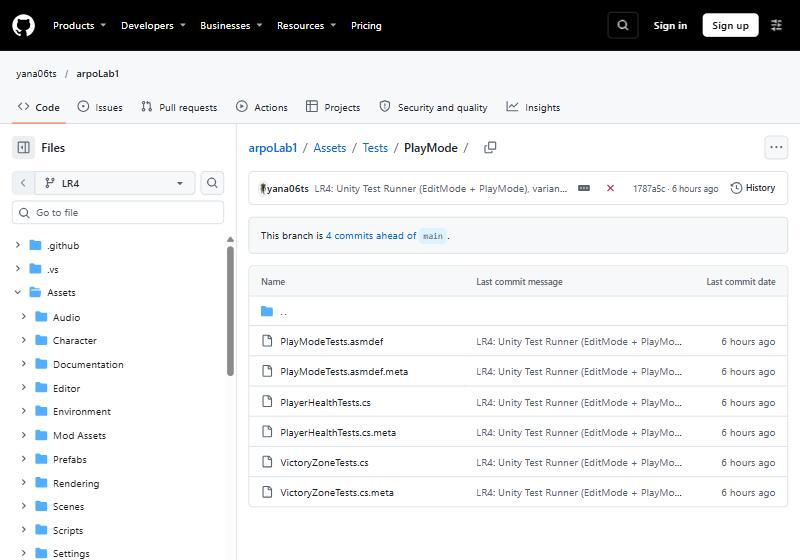
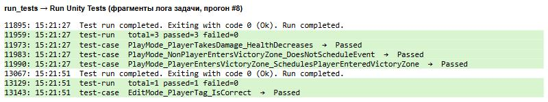
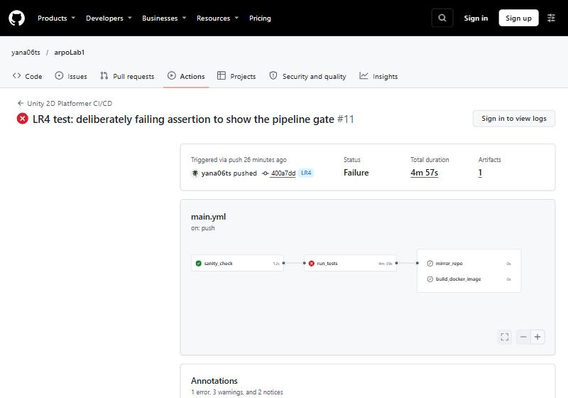
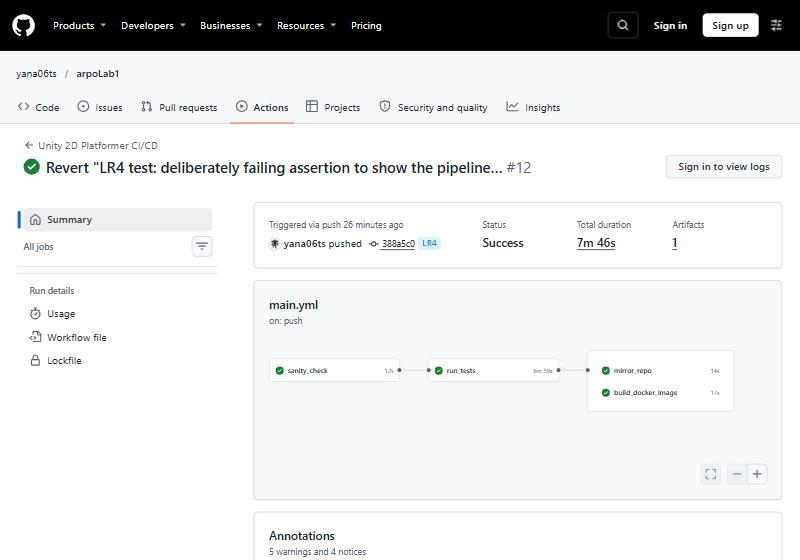

# Лабораторная работа №4

**Тема:** автоматизация тестирования (Unity Test Runner) в CI/CD.

**Индивидуальный вариант:** №16 — `PlayerEnteredVictoryZone`, тип PlayMode: «Вход игрока в VictoryZone планирует событие».

**Проект:** Unity 6000.3.2f1, 2D Platformer Microgame.
**Репозиторий:** https://github.com/yana06ts/arpoLab1

## 1. Разделение кода на сборки (Assembly Definitions)

| Файл | Сборка | Назначение |
| --- | --- | --- |
| `Assets/Scripts/GameAssembly.asmdef` | GameAssembly | Весь игровой код (`Platformer.*`). Ссылается на `Unity.InputSystem` и `Unity.Cinemachine` |
| `Assets/Tests/EditMode/Tests.asmdef` | Tests | EditMode-тесты: `includePlatforms: ["Editor"]` |
| `Assets/Tests/PlayMode/PlayModeTests.asmdef` | PlayModeTests | PlayMode-тесты: `includePlatforms` пуст |

Обе тестовые сборки ссылаются на `GameAssembly`, `UnityEngine.TestRunner`, `UnityEditor.TestRunner` и `nunit.framework.dll`. Они компилируются только при `UNITY_INCLUDE_TESTS`, поэтому в WebGL-сборку игры не попадают.

`Assets/Editor/BuildManager.cs`, `PatrolPathEditor.cs` и скрипты из `Mod Assets` остались в стандартных сборках Unity. Эти сборки автоматически видят `GameAssembly`, потому что у неё `autoReferenced: true`.

В `TemplateEditorDetection.cs` поиск типа `Platformer.Core.Simulation` теперь сначала выполняется в сборке `GameAssembly`. До изменения тип искался только в Assembly-CSharp, и после переноса кода он бы не находился.

## 2. Тесты

| Тест | Режим | Что проверяет |
| --- | --- | --- |
| `PlayerTests.EditMode_PlayerTag_IsCorrect` | EditMode | В `SampleScene` есть объект `Player` с тегом Player и компонентами `PlayerController` и `Health` |
| `PlayerHealthTests.PlayMode_PlayerTakesDamage_HealthDecreases` | PlayMode | `Health.Decrement()` уменьшает HP; после 3 ударов при `maxHP = 3` игрок мёртв |
| `VictoryZoneTests.PlayMode_PlayerEntersVictoryZone_SchedulesPlayerEnteredVictoryZone` | PlayMode | **Вариант 16**, основной сценарий |
| `VictoryZoneTests.PlayMode_NonPlayerEntersVictoryZone_DoesNotScheduleEvent` | PlayMode | **Вариант 16**, проверка от ложных срабатываний |

Тест варианта является PlayMode-тестом, поэтому он находится в сборке `PlayModeTests` (`Assets/Tests/PlayMode/VictoryZoneTests.cs`), а не в EditMode-сборке `Tests`. В режиме EditMode физика и `OnTriggerEnter2D` не работают.

### Сценарий теста по варианту 16

1. Создаются зона победы (`BoxCollider2D` с `isTrigger = true` и реальный компонент `VictoryZone`) и игрок (`Rigidbody2D`, коллайдер, `Health` и реальный `PlayerController`).
2. Игрок стоит в 20 единицах от зоны. Тест ждёт несколько шагов физики и проверяет, что событие **не** запланировано.
3. Игрок перемещается в зону игровым методом `KinematicObject.Teleport`. Физика Unity вызывает `VictoryZone.OnTriggerEnter2D`.
4. Тест читает очередь `Simulation` через отражение: поле `eventQueue` приватное. В очереди должно быть событие `PlayerEnteredVictoryZone`, а его `victoryZone` должно указывать на созданную зону. Так проверяется само **планирование** события.
5. Затем вызывается `Simulation.Tick()`, как в `GameController.Update()`. Событие выполняется: срабатывает `OnExecute`, у игрока отключается управление (`controlEnabled == false`).

Негативный тест помещает в зону объект без `PlayerController`. Событие победы в этом случае не планируется.

### Результат локального запуска

Тесты запущены в Unity 6000.3.2f1 из командной строки в режиме `-batchmode -runTests`. Скрипт: [docs/LR4/run_tests_local.bat](docs/LR4/run_tests_local.bat).

| Режим | Всего | Пройдено | Ошибки |
| --- | ---: | ---: | ---: |
| EditMode | 1 | 1 | 0 |
| PlayMode | 3 | 3 | 0 |

**Результат теста по варианту 16: Passed.** Отчёты NUnit: [editmode-results.xml](docs/LR4/test-results/editmode-results.xml), [playmode-results.xml](docs/LR4/test-results/playmode-results.xml).

Тесты запускались тем же Unity Test Runner, что и в окне Window → General → Test Runner, но из командной строки (`-runTests`). Поэтому результат сохранён в виде отчётов NUnit, а не скриншота окна.

### Тесты в репозитории

## 3. Тесты в GitHub Actions

Задача `run_tests` добавлена после `sanity_check`. Файл пайплайна на этапе ЛР4: [docs/LR4/main.lr4.yml](docs/LR4/main.lr4.yml).

- Устанавливается GameCI CLI v0.1.72. Команда `game-ci test` запускает тесты в контейнере `unityci/editor` для `playmode;editmode;COMBINE_RESULTS`.
- Указывается `--engineVersion=6000.3.2f1`, то есть версия проекта.
- Задаётся `--coverageEnabled=false`: инструментирование покрытия роняет Unity 6 в контейнере (SIGSEGV, код 139).
- Папка `Library` кэшируется.
- Результаты сохраняются артефактом `test-results` даже при ошибке (`if: always()`).
- `mirror_repo` и `build_docker_image` содержат `needs: run_tests`. Если хотя бы один тест падает, эти задачи не запускаются.

### Секреты репозитория

GitHub → Settings → Secrets and variables → Actions:

- `UNITY_LICENSE` — всё содержимое файла `.ulf` (Windows: `C:\ProgramData\Unity\Unity_lic.ulf`);
- `UNITY_EMAIL` — email аккаунта Unity;
- `UNITY_PASSWORD` — пароль аккаунта Unity. Если аккаунт создан через Google или Apple, сначала задайте пароль. Двухфакторная аутентификация должна быть выключена.

### Результат в облаке

Первый прогон ветки `LR4` (#4) упал на `run_tests`: секреты Unity ещё не были добавлены, и редактор в контейнере не смог активировать лицензию. После добавления `UNITY_LICENSE`, `UNITY_EMAIL` и `UNITY_PASSWORD` тесты в облаке проходят. Проходят и в последующих ветках `LR5` и `LR6`, где эта же задача стоит перед сборкой.

Секреты репозитория (значения скрыты GitHub):

Фрагмент лога задачи `run_tests` в облаке: PlayMode 3/3 и EditMode 1/1 пройдены, Unity завершился с кодом 0. Для читаемости из лога оставлены только строки с результатами.

### Проверка защиты пайплайна

1. В `PlayerTests.cs` временно добавлена строка `Assert.AreEqual(1, 2, "Демонстрация: тест специально сломан");` (коммит `400a7dd`).
2. Прогон #11 красный: `run_tests` упал, а `mirror_repo` и `build_docker_image` **пропущены**. Сломанный код не попал ни в резервный репозиторий, ни в GHCR.

3. Изменение отменено через `git revert` (коммит `388a5c0`). Прогон #12 снова полностью зелёный:

## Как это работает простыми словами

Тест — это маленькая программа, которая запускает часть игры и сравнивает результат с ожидаемым. EditMode-тест открывает сцену и проверяет её настройку. PlayMode-тест на доли секунды запускает игровую логику с физикой.

В игре события работают через очередь `Simulation`. Код говорит «запланируй событие», а `GameController` выполняет его в следующем кадре. Тест варианта 16 проверяет обе части: зона ставит событие в очередь, а после выполнения игрок теряет управление, как при прохождении уровня.

В облаке GitHub запускает те же тесты в контейнере с Unity. Пока все тесты не пройдут, сборка и публикация не начинаются.

## Контрольные вопросы

**1. Чем EditMode отличается от PlayMode?**
EditMode-тесты выполняются в редакторе без запуска игрового цикла. Они быстро проверяют сцены, префабы и настройки. PlayMode-тесты запускают игровой цикл: `Awake`, `Update`, физику и корутины. Ими проверяют поведение, например урон и срабатывание триггеров.

**2. Какую роль играет .asmdef?**
Файл делит код на отдельные сборки. Тестовая сборка получает ссылку на `GameAssembly` и может использовать игровые классы. Тестовые библиотеки (NUnit, TestRunner) при этом не попадают в игру. Без `.asmdef` игровой код находится в Assembly-CSharp, а на неё тестовая сборка сослаться не может.

**3. Зачем build_docker_image нужен needs: run_tests?**
Чтобы образ собирался и публиковался только из проверенного кода. При падении теста зависимые задачи пропускаются, и сломанная версия не попадает в GHCR.

**4. Как includePlatforms влияет на режим тестов?**
`"includePlatforms": ["Editor"]` означает, что сборка существует только в редакторе. Unity запускает её тесты в EditMode. Пустой список означает сборку для всех платформ, и её тесты запускаются в PlayMode.
