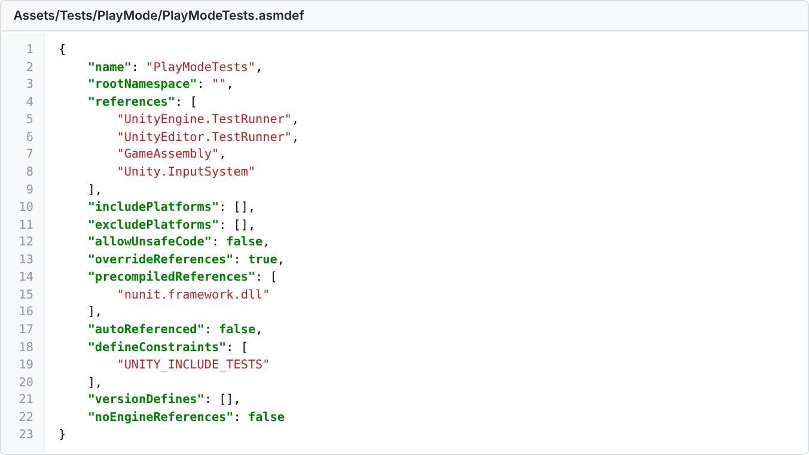
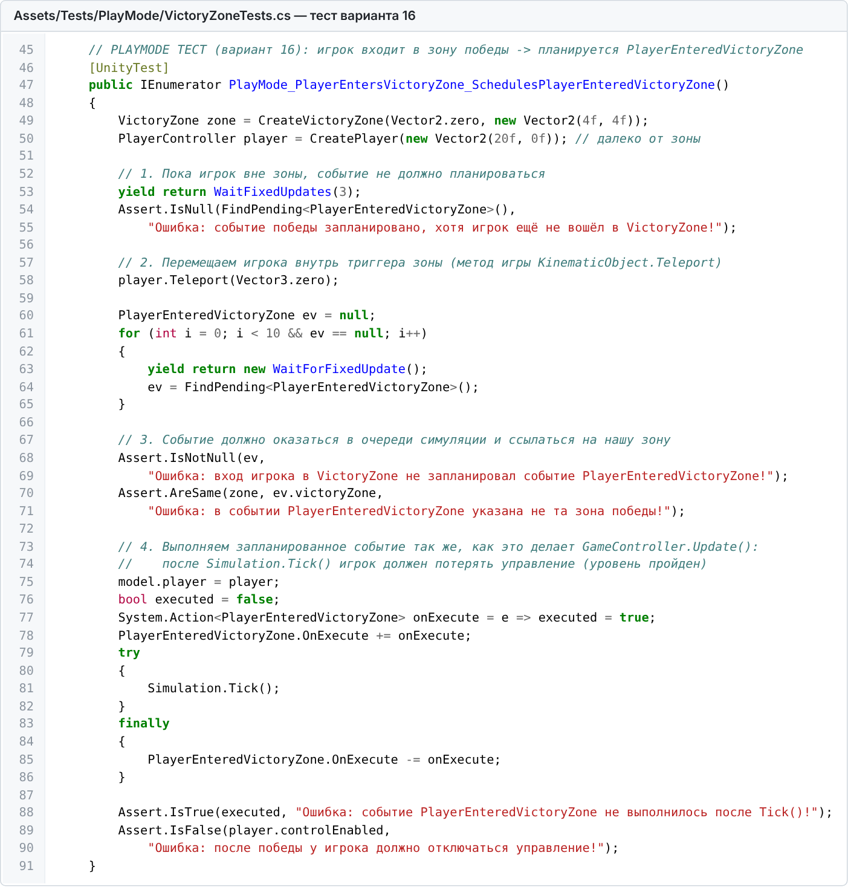
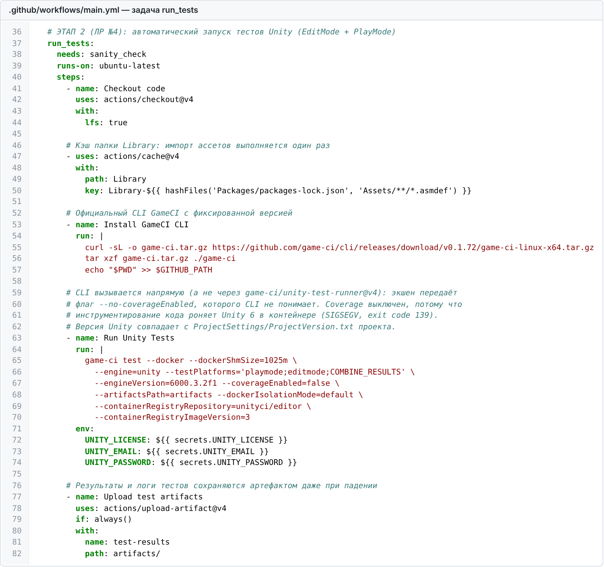
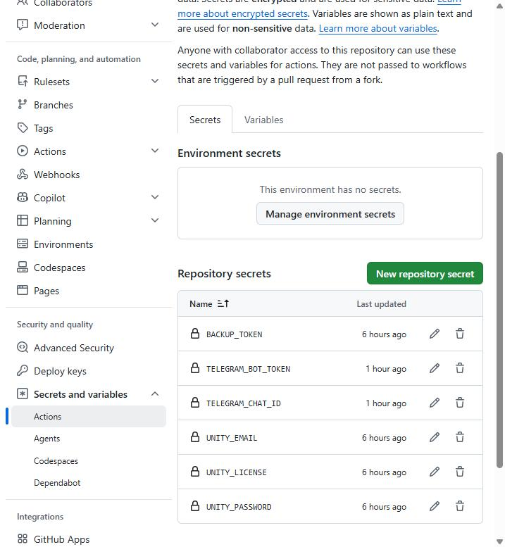

# Лабораторная работа №4. Автоматизация тестирования (Unity Test Runner) в CI/CD

Индивидуальный вариант: 16. Механика PlayerEnteredVictoryZone, тип PlayMode: вход игрока в VictoryZone планирует событие.

## 1. Assembly Definitions

Код игры вынесен в отдельную сборку Assets/Scripts/GameAssembly.asmdef. Тесты лежат в двух сборках:

- Assets/Tests/EditMode/Tests.asmdef, с параметром includePlatforms: Editor, запускается в режиме EditMode;
- Assets/Tests/PlayMode/PlayModeTests.asmdef, без includePlatforms, запускается в режиме PlayMode.

Обе тестовые сборки ссылаются на GameAssembly и в сборку игры не попадают.

## 2. Тесты

- EditMode_PlayerTag_IsCorrect: на сцене SampleScene есть объект Player с тегом Player и компонентами PlayerController и Health.
- PlayMode_PlayerTakesDamage_HealthDecreases: Health.Decrement() уменьшает здоровье, после трёх ударов персонаж погибает.
- PlayMode_PlayerEntersVictoryZone_SchedulesPlayerEnteredVictoryZone: тест варианта 16.
- PlayMode_NonPlayerEntersVictoryZone_DoesNotScheduleEvent: объект без PlayerController не вызывает победу.

Тест варианта 16 создаёт зону победы и игрока с настоящими скриптами игры. Пока игрок далеко, событие не планируется. После перемещения игрока в зону физика Unity вызывает VictoryZone, и в очереди Simulation появляется событие PlayerEnteredVictoryZone с этой зоной. После Simulation.Tick() событие выполняется, и у игрока отключается управление.

Локальный запуск в Unity 6000.3.2f1: EditMode 1 из 1, PlayMode 3 из 3. Результат теста по варианту: Passed.

## 3. Запуск тестов в GitHub Actions

Задача run_tests запускает тесты в контейнере unityci/editor через GameCI CLI в режимах playmode и editmode. Покрытие кода отключено, потому что оно роняет Unity 6 в контейнере. Задачи mirror_repo и build_docker_image зависят от run_tests и без успешных тестов не запускаются.

Лицензия Unity передаётся через секреты UNITY_LICENSE, UNITY_EMAIL и UNITY_PASSWORD.

В облаке пройдены все тесты: PlayMode 3 из 3, EditMode 1 из 1.

## 4. Проверка защиты пайплайна

В тест временно добавлена строка Assert.AreEqual(1, 2). Задача run_tests упала, а mirror_repo и build_docker_image были пропущены. Затем изменение отменено, и следующий прогон снова зелёный.

