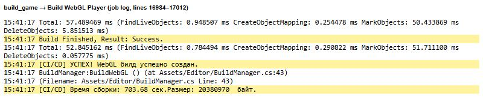

## 1. Настройки Unity для GitHub Pages

Формат сжатия остался Gzip, включён Decompression Fallback. В ProjectSettings.asset это значения webGLCompressionFormat: 1 и webGLDecompressionFallback: 1. В Unity значение 1 означает Gzip, а 0 означает Brotli. GitHub Pages не отправляет заголовок Content-Encoding, поэтому файлы распаковывает встроенный в сборку JS-распаковщик Unity. При включённом Fallback файлы сборки называются .unityweb.

## 2. Задача build_game

После успешных тестов задача build_game собирает WebGL в контейнере через game-ci/unity-builder. Сборку выполняет метод BuildManager.BuildWebGL из ЛР1, версия Unity 6000.3.2f1. Готовая папка Builds/WebGL загружается в артефакт WebGL-Build.

Файл BuildManager.cs переведён в кодировку UTF-8, чтобы русские сообщения читались в облачном логе. В логе видно, что сборку выполнил именно метод из ЛР1: сборка шла 703,68 с, её размер 20 380 970 байт.

## 3. Docker-образ и GitHub Pages

Задачи build_docker_image и deploy_to_pages скачивают артефакт WebGL-Build вместо заглушек из ЛР3. Первая собирает образ с Nginx и публикует его в GHCR. Вторая выкладывает игру в ветку gh-pages. В nginx.conf добавлены правила для файлов .unityweb с заголовком Content-Encoding: gzip.

Все задачи пайплайна выполнены успешно, build_game запускается после run_tests.

## 4. Результаты

В ветке gh-pages лежат index.html, Build, TemplateData и .nojekyll. В папке Build настоящие файлы: WebGL.wasm.unityweb (12 МБ), WebGL.data.unityweb (8,2 МБ), WebGL.framework.js.unityweb и WebGL.loader.js.

GitHub Pages включён один раз вручную: Settings, Pages, источник gh-pages, папка root.

Игра открывается по адресу yana06ts.github.io/arpoLab1, персонаж управляется с клавиатуры. Все файлы игры загружаются с кодом 200, ошибок распаковки в консоли нет.

Пакет platformer-game опубликован в GHCR. Тег latest и тег с SHA указывают на образ последнего коммита.

Образ скачан из GHCR и запущен локально на порту 8081. Nginx отдаёт WebGL.wasm.unityweb с кодом 200, заголовками Content-Type: application/wasm и Content-Encoding: gzip.

