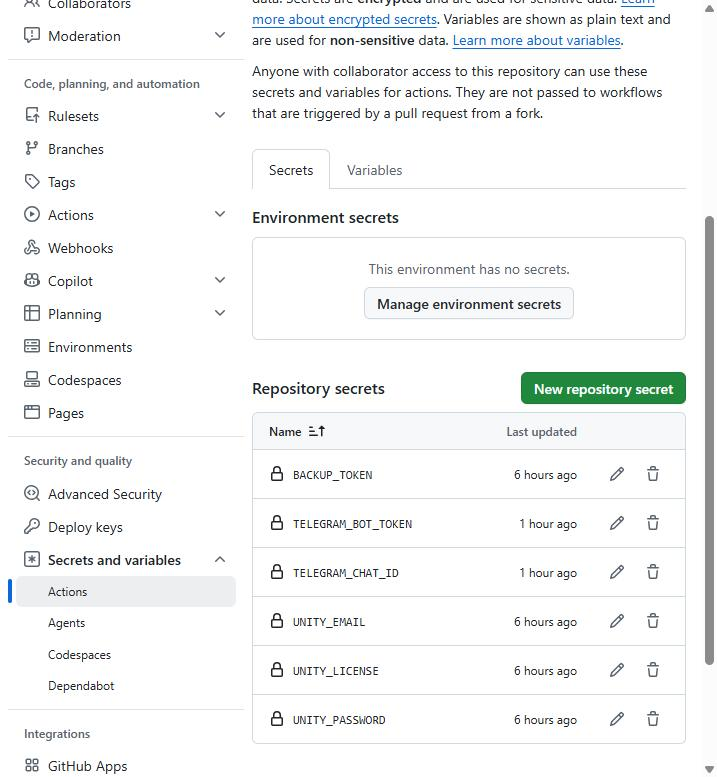
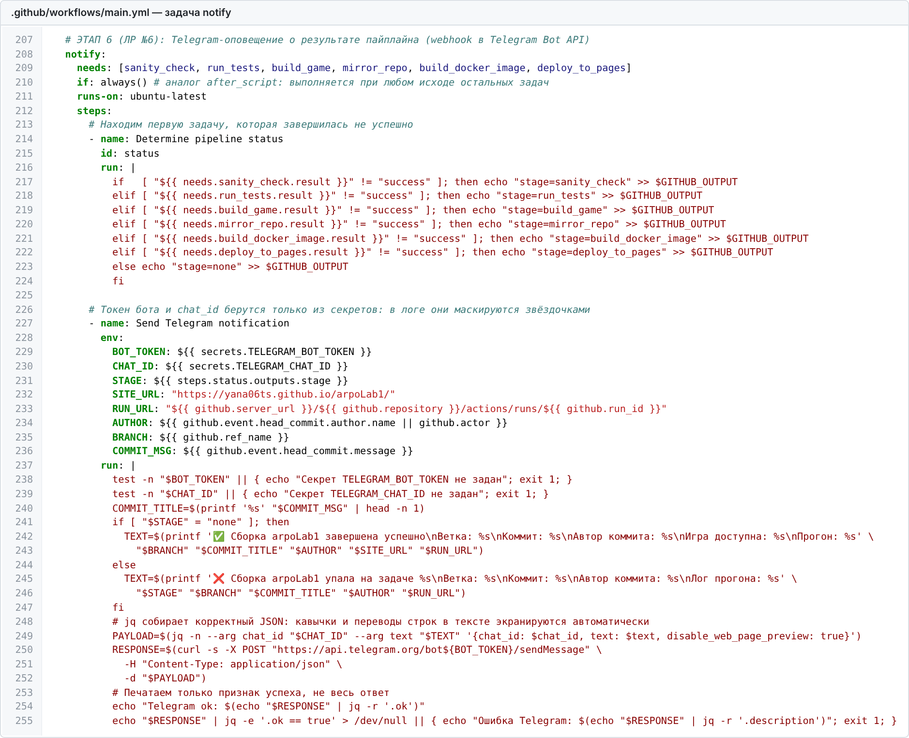
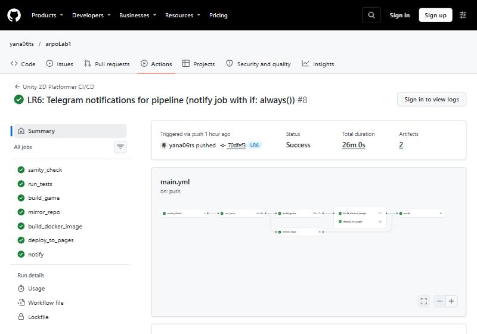
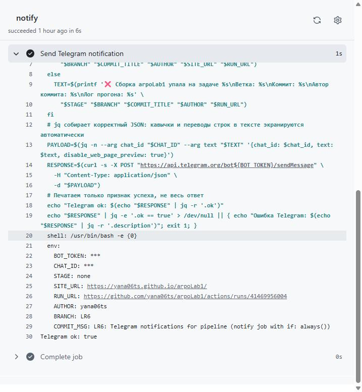
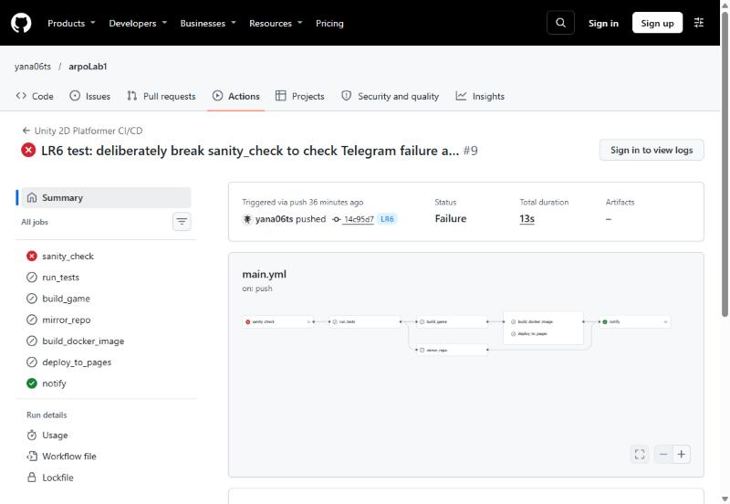
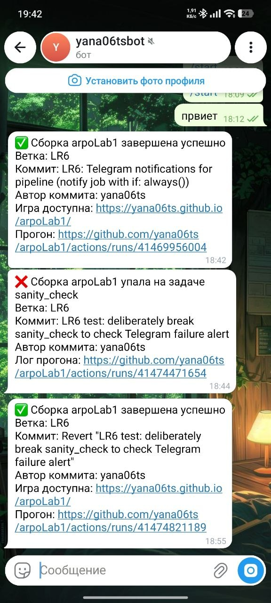

## 1. Telegram-бот

Раньше узнать результат сборки можно было, только открыв GitHub. Теперь о каждой сборке сообщает Telegram-бот. Бота создали через официального бота BotFather, получили токен — это пароль бота. Боту написали первое сообщение, иначе он не может писать сам, и через Telegram API узнали номер чата, куда отправлять сообщения.

## 2. Секреты

Токен бота и номер чата — это секретные данные: зная токен, любой может писать от имени бота. Поэтому их не пишут в код, а хранят в секретах репозитория на GitHub. В логах GitHub автоматически заменяет их звёздочками.

## 3. Задача уведомления

В конец пайплайна добавили задачу уведомления. Она ждёт, пока закончатся все остальные задачи, и выполняется всегда, даже если какие-то из них упали, за это отвечает условие if: always(). Сначала она смотрит, какая задача упала первой. Потом отправляет запрос в Telegram с текстом сообщения. Если Telegram сообщение не принял, задача становится красной, и это сразу видно.

## 4. Успешная сборка

Все задачи прошли успешно. Бот прислал сообщение с отметкой ✅, ссылкой на игру, автором коммита и ссылкой на прогон.

В логе задачи уведомления токен и номер чата скрыты звёздочками, а Telegram ответил, что сообщение принято.

## 5. Сломанная сборка

Чтобы проверить второй сценарий, в первую задачу пайплайна, проверку структуры проекта, временно добавили проверку несуществующей папки. Эта задача упала, все следующие были пропущены, а задача уведомления всё равно выполнилась. Бот прислал сообщение с отметкой ❌ и названием упавшей задачи. После этого изменение отменили, и сборка снова прошла успешно.

## 6. Сообщения на телефоне

Все три сообщения пришли на телефон: об успешной сборке, о падении проверки структуры и снова об успешной сборке после исправления.

