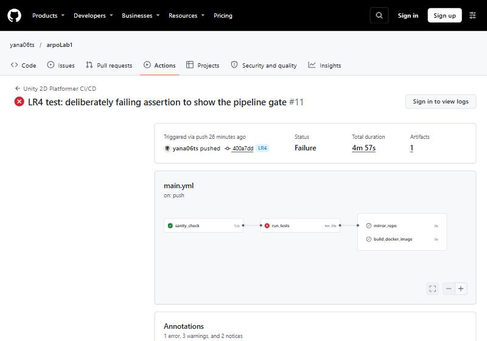
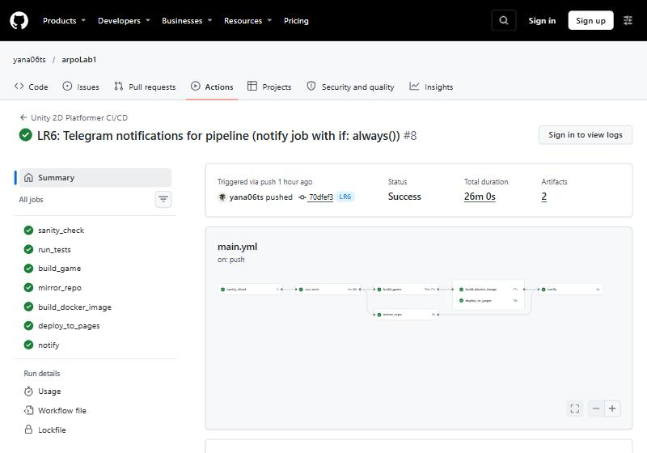
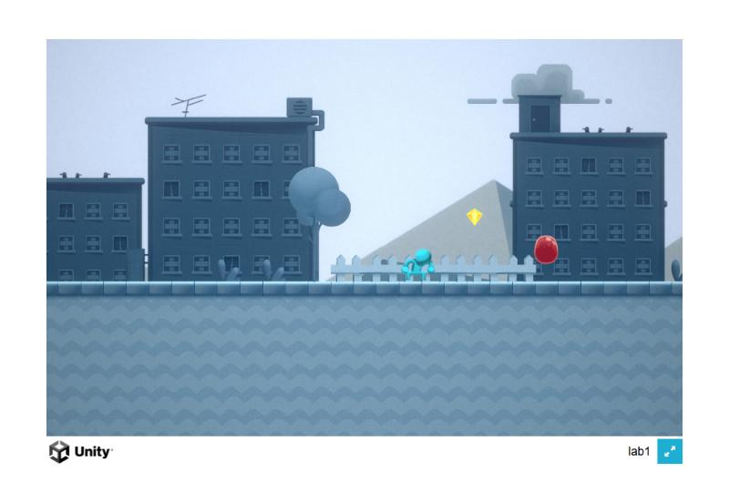

# ARPO — Unity 2D Platformer

Учебный проект Unity 6000.3.2f1 на основе 2D Platformer Microgame.

| Работа | Содержание | Отчёт |
| --- | --- | --- |
| ЛР №1 | Автоматическая WebGL-сборка из командной строки | [LR1.md](LR1.md) |
| ЛР №2 | GitHub Actions и резервный репозиторий | [LR2.md](LR2.md) |
| ЛР №3 | Gzip, Nginx, Docker и GHCR | [LR3.md](LR3.md) |
| ЛР №4 | Unity Test Runner в CI/CD (вариант 16) | [LR4.md](LR4.md) |
| ЛР №5 | Облачная сборка WebGL, GitHub Pages, Docker с игрой | [LR5.md](LR5.md) |
| ЛР №6 | Мониторинг пайплайна, webhooks и Telegram-оповещения | [LR6.md](LR6.md) |

## Локальный запуск

Нужны Docker Desktop с запущенным Linux Engine и готовая сборка в `Builds/WebGL`.

```powershell
# Для установленного на этом компьютере Docker, если команда docker не найдена:
$env:Path += ";$env:LOCALAPPDATA\Programs\DockerDesktop\resources\bin"
docker build -t platformer-compressed:v1 .
docker run -d -p 127.0.0.1:8081:80 --name unity_compressed_container platformer-compressed:v1
```

Открыть http://localhost:8081. Контейнер доступен только на этом компьютере.

После проверки:

```powershell
docker stop unity_compressed_container
docker rm unity_compressed_container
```

## Тесты (ЛР №4)

- `Assets/Scripts/GameAssembly.asmdef` — игровой код;
- `Assets/Tests/EditMode` — EditMode-тесты сцены;
- `Assets/Tests/PlayMode` — PlayMode-тесты здоровья и зоны победы (вариант 16).

Локальный запуск: Window → General → Test Runner → Run All или [docs/LR4/run_tests_local.bat](docs/LR4/run_tests_local.bat). Результат: EditMode 1/1, PlayMode 3/3, включая тест варианта 16.

Если тест падает, сборка и публикация не запускаются:



## Что хранится в облаке (ЛР №5)

После каждого push GitHub Actions выполняет:

1. `sanity_check` — проверку структуры;
2. `run_tests` — EditMode- и PlayMode-тесты;
3. `build_game` — сборку WebGL в облаке методом `BuildManager.BuildWebGL`.

Затем параллельно запускаются:

- `mirror_repo` — копия в `yana06ts/arpoLab2`;
- `build_docker_image` — образ `ghcr.io/yana06ts/platformer-game` с настоящей игрой под тегами `latest` и SHA;
- `deploy_to_pages` — публикация в ветку `gh-pages`.

В конце всегда выполняется `notify` (ЛР №6): Telegram-бот присылает результат прогона, а при ошибке — имя упавшей задачи.

Игра: https://yana06ts.github.io/arpoLab1/ (Pages включается один раз: Settings → Pages → `gh-pages`).

Нужные секреты: `UNITY_LICENSE`, `UNITY_EMAIL`, `UNITY_PASSWORD`, `BACKUP_TOKEN`, `TELEGRAM_BOT_TOKEN`, `TELEGRAM_CHAT_ID`.

Запуск опубликованного образа с игрой:

```powershell
docker run -d -p 127.0.0.1:8081:80 --name platformer ghcr.io/yana06ts/platformer-game:latest
```

### Пайплайн и игра





Скриншоты по работам: [ЛР3](docs/LR3/screenshots), [ЛР4](docs/LR4/screenshots), [ЛР5](docs/LR5/screenshots), [ЛР6](docs/LR6/screenshots).
